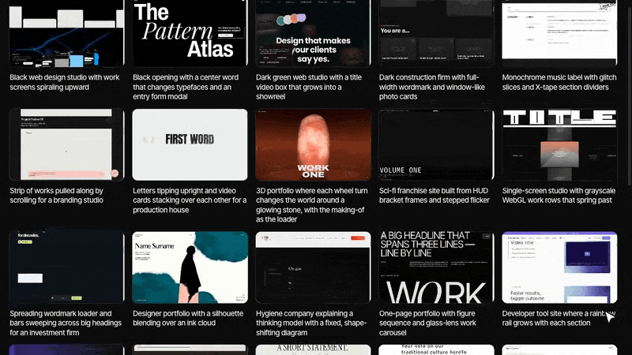

<p align="center">
  <a href="https://sionic-ai.github.io/rea-design"></a>
</p>

<h1 align="center">rea-design</h1>

<p align="center">
  <b>1,009 well-made websites rebuilt as code, plus 2,253 ready motion effects.</b><br>
  A Claude Code plugin: ask for a page, a hover effect or a video, and Claude starts from a real design instead of a blank one.
</p>

<p align="center">
  <a href="https://sionic-ai.github.io/rea-design"><b>Browse the gallery</b></a> ·
  <a href="#install">Install</a> ·
  <a href="#use">Use</a> ·
  <a href="docs/">Docs</a>
</p>

---

## Install

```sh
claude plugin marketplace add sionic-ai/rea-design
claude plugin install rea-design@rea-design
```

For videos, also install [HyperFrames](https://github.com/heygen-com/hyperframes):

```sh
claude plugin marketplace add heygen-com/hyperframes
claude plugin install hyperframes@hyperframes
```

## Use

**Just ask.** Claude picks the right references on its own.

- *"Make a landing page for a small café, calm and warm."*
- *"Add a magnetic hover to the buttons on my page."*
- *"Make a 30-second launch video for our app."*
- *"Pick colors and fonts for this site."* / *"It breaks on mobile, fix it."*

**Or pick it yourself.**

- `/rea-design:browse cafe`: open the gallery and look around
- `/rea-design:pick portfolio for a photographer`: see three options, then choose one
- `/rea-design:use <name>`: build from the site or effect you chose

## How it looks

Every site in the [gallery](https://sionic-ai.github.io/rea-design) is a live page. Click a card to open it and scroll through. Text, photos and names are placeholders: Claude keeps the layout and the motion and puts your content in.

## Docs

- [How it works](docs/how-it-works.md): routing, what Claude does with a reference, the rules it follows
- [The `rea` CLI](docs/cli.md): every command, if you want to search the library yourself
- [What's in the library](docs/library.md): numbers, categories, and how the rebuilds were made
- [Full catalog](CATALOG.md): every site and effect with a live link

## License

MIT © [Sionic AI](https://sionic.ai). Third-party code keeps its own license; see [NOTICE.md](NOTICE.md).
